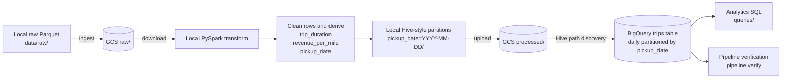

# Taxi Data Pipeline

A batch ELT pipeline that uploads local NYC taxi Parquet files to Google Cloud
Storage, cleans and enriches them with local PySpark, and loads the result into
a daily partitioned BigQuery table.

## Architecture



The pipeline has three executable stages:

1. `pipeline.ingest` uploads local raw Parquet files to `gs://<bucket>/raw/`.
2. `pipeline.transform` downloads raw files, runs PySpark transformations, and
   uploads Hive-style date partitions to `gs://<bucket>/processed/`.
3. `pipeline.load_to_bq` loads the processed files into BigQuery.

`main.py` runs those stages in order and reports the duration and failure point
for each stage.

## Repository Layout

```text
.
├── main.py                 # Pipeline orchestrator
├── pipeline/
│   ├── config.py           # Environment-based configuration
│   ├── ingest.py           # Local Parquet to GCS
│   ├── transform.py        # PySpark cleaning and enrichment
│   ├── load_to_bq.py       # GCS to partitioned BigQuery table
│   └── verify.py           # Post-load checks
├── queries/                # BigQuery analytics queries
├── tests/                  # Mocked GCP and local PySpark tests
├── .env.example
└── pyproject.toml
```

## Prerequisites

- Python 3.14
- [`uv`](https://docs.astral.sh/uv/)
- Java 17 or newer for PySpark
- A Google Cloud project with billing enabled
- Google Cloud CLI, including the `gcloud` and `bq` commands
- NYC yellow taxi data in Parquet format

Check the local tools:

```bash
python --version
uv --version
java -version
gcloud --version
```

## Local Setup

1. Install the locked dependencies:

   ```bash
   uv sync
   ```

2. Create the environment file:

   ```bash
   cp .env.example .env
   ```

3. Set the required values in `.env`:

   ```dotenv
   GCS_BUCKET=your-globally-unique-bucket-name
   BQ_PROJECT=your-gcp-project-id
   BQ_DATASET=taxi_analytics
   ```

4. Put one or more source files in `data/raw/`:

   ```text
   data/raw/yellow_tripdata_YYYY-MM.parquet
   ```

The source data must include:

- `tpep_pickup_datetime`
- `tpep_dropoff_datetime`
- `trip_distance`
- `fare_amount`
- `PULocationID`
- `DOLocationID`

Optional configuration values and their defaults are documented in
[`.env.example`](.env.example).

## GCP Setup

Keep the GCS bucket and BigQuery dataset in the same location. Cross-location
load jobs are not supported.

### Option A: Google Cloud CLI

Set reusable shell variables:

```bash
export PROJECT_ID="your-gcp-project-id"
export GCP_LOCATION="northamerica-northeast2"
export GCS_BUCKET="your-globally-unique-bucket-name"
export BQ_DATASET="taxi_analytics"
gcloud config set project "$PROJECT_ID"
```

Authenticate and create Application Default Credentials:

```bash
gcloud auth login
gcloud auth application-default login
```

Enable the required APIs:

```bash
gcloud services enable storage.googleapis.com bigquery.googleapis.com
```

Create the bucket and dataset:

```bash
gcloud storage buckets create "gs://$GCS_BUCKET" \
  --project="$PROJECT_ID" \
  --location="$GCP_LOCATION" \
  --uniform-bucket-level-access

bq --location="$GCP_LOCATION" mk \
  --dataset \
  "$PROJECT_ID:$BQ_DATASET"
```

The identity running the pipeline needs these roles:

- `roles/storage.objectAdmin`
- `roles/bigquery.dataEditor`
- `roles/bigquery.jobUser`

For local development, grant them to your signed-in account or use a dedicated
service account. Project-level service-account setup:

```bash
gcloud iam service-accounts create taxi-pipeline \
  --display-name="Taxi pipeline"

export PIPELINE_SA="taxi-pipeline@$PROJECT_ID.iam.gserviceaccount.com"

gcloud projects add-iam-policy-binding "$PROJECT_ID" \
  --member="serviceAccount:$PIPELINE_SA" \
  --role="roles/storage.objectAdmin"
gcloud projects add-iam-policy-binding "$PROJECT_ID" \
  --member="serviceAccount:$PIPELINE_SA" \
  --role="roles/bigquery.dataEditor"
gcloud projects add-iam-policy-binding "$PROJECT_ID" \
  --member="serviceAccount:$PIPELINE_SA" \
  --role="roles/bigquery.jobUser"
```

Application Default Credentials are preferred. If a key file is unavoidable,
store it under the ignored `secrets/` directory and set:

```bash
export GOOGLE_APPLICATION_CREDENTIALS="secrets/service-account.json"
```

### Option B: Google Cloud Console

1. Open **APIs & Services > Library** and enable **Cloud Storage API** and
   **BigQuery API**.
2. Open **Cloud Storage > Buckets**, create a bucket, select a location, and
   enable uniform bucket-level access.
3. Open **BigQuery Studio**, select the project, choose **Create dataset**, and
   use the same location as the bucket.
4. Open **IAM & Admin > IAM** and grant the pipeline identity Storage Object
   Admin, BigQuery Data Editor, and BigQuery Job User.
5. For a service account, open **IAM & Admin > Service Accounts**, create the
   account, assign those roles, and use Application Default Credentials or a
   key stored outside version control.

For production, narrow project-level roles to the target bucket and dataset
where practical.

## Running the Pipeline

Run every stage:

```bash
uv run python main.py
```

Run only selected stages:

```bash
# Transform and load existing raw objects from GCS
uv run python main.py --skip-ingest

# Load existing processed objects into BigQuery
uv run python main.py --skip-ingest --skip-transform

# Ingest and transform without loading BigQuery
uv run python main.py --skip-load
```

Each module can also run independently:

```bash
uv run python -m pipeline.ingest
uv run python -m pipeline.transform
uv run python -m pipeline.load_to_bq
```

The current BigQuery load uses `WRITE_TRUNCATE`. Running the load stage replaces
all rows in the configured destination table. It does not delete GCS objects.

## Verification and Tests

Verify the live BigQuery table:

```bash
uv run python -m pipeline.verify
```

The verifier checks:

1. The table contains rows.
2. `pickup_date`, `trip_duration`, and `revenue_per_mile` exist and reports
   their null counts.
3. A query filtered by `pickup_date` scans fewer bytes than an unfiltered query.

Run the isolated test suite:

```bash
uv run pytest
```

Tests use an in-memory local Spark session and mocked BigQuery clients. They do
not read from or write to GCP.

## Design Decisions

### Why both Hive and BigQuery time partitioning are required

PySpark writes the transformed data with:

```python
df.write.partitionBy("pickup_date").parquet(path)
```

This produces paths such as:

```text
processed/pickup_date=2026-05-01/part-00000.parquet
```

The important gotcha is that Spark removes `pickup_date` from each Parquet
file. The value exists only in the directory name.

`HivePartitioningOptions` tells BigQuery to parse those directory names and
reconstruct `pickup_date` as a column. That solves schema discovery, but it does
not by itself guarantee that the destination is a native BigQuery partitioned
table.

`TimePartitioning(field="pickup_date")` separately tells BigQuery to physically
organize the destination table into daily partitions. This enables partition
pruning and reduces bytes scanned for date-filtered queries.

Without native time partitioning, `pickup_date` can appear in the schema while
the table remains unpartitioned. This pipeline's verification caught exactly
that failure mode: the filtered query scanned more bytes because it had to read
both `fare_amount` and `pickup_date` across the complete table.

### Data quality rules

The transform drops rows missing required timestamps, distances, fares, or
location IDs. It also rejects non-positive fares and distances before deriving:

- `trip_duration`, in minutes
- `revenue_per_mile`
- `pickup_date`, used for storage partitioning

### Reload strategy

The current implementation favors deterministic full refreshes through
`WRITE_TRUNCATE`. This avoids duplicate rows during reruns, but it replaces the
entire table.

For incremental processing, load only changed dates into partition decorators
such as `project.dataset.trips$20260501` with `WRITE_TRUNCATE`. That replaces one
daily partition without affecting other dates. Row-level upserts would require
a staging table and a stable trip identifier before using `MERGE`.

## Analytics Queries

The `queries/` directory contains three BigQuery examples:

1. Hourly revenue by pickup zone.
2. Average trip duration by weekday.
3. Top pickup and drop-off zones by revenue.

Replace `YOUR_PROJECT_ID.YOUR_DATASET` in each query with the destination from
your `.env`, then run the query in BigQuery Studio after verification succeeds.

## Troubleshooting

- **Missing environment variable:** copy `.env.example` to `.env` and set all
  required values.
- **DefaultCredentialsError:** run `gcloud auth application-default login` or
  set `GOOGLE_APPLICATION_CREDENTIALS`.
- **BigQuery location error:** confirm the bucket and dataset use the same
  location.
- **PySpark Java gateway error:** install Java 17 or newer and confirm
  `java -version` works.
- **Partition pruning fails:** inspect the table details in BigQuery and confirm
  it is partitioned by `pickup_date`, then perform the required one-time reload.
